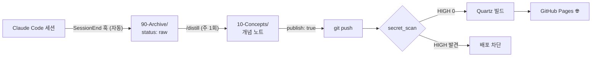

<div align="center">

# █ LLM WIKI

**세션에서 지식으로 — Claude Code 작업 기록을 정제해 쌓는 개인 LLM 위키**

[](https://joon56.github.io/my-llm-wiki/)
[](https://github.com/joon56/my-llm-wiki/actions/workflows/deploy.yml)
[](https://quartz.jzhao.xyz)
[](https://obsidian.md)
[](#-테스트)

[Obsidian](https://obsidian.md)으로 쓰고 · [Quartz 4](https://quartz.jzhao.xyz)로 빌드하고 · GitHub Pages로 발행한다.
Claude Code 세션은 자동 아카이브되고, `/distill` 루틴이 재사용 가능한 교훈만 개념 노트로 승격한다.

**[→ 위키 보러 가기](https://joon56.github.io/my-llm-wiki/)** · KR/EN 토글 지원 · 라이트 = 브루탈리즘 / 다크 = 네온

</div>

---

## 📐 파이프라인



세 개의 층: **원본 아카이브**(자동 수집, 절대 비공개) → **개념 노트**(사람이 정제) → **MOC**(주제별 지도). 로그가 아니라 로그에서 뽑은 결론이 위키다.

## 🗂 구조

```
LLM_WIKI/                        ← git 루트 (모노레포)
├── vault/                       ← Obsidian 볼트. 콘텐츠 전부
│   ├── 00-Inbox/                # 미정제 메모. 주 1회 비움
│   ├── 10-Concepts/             # ★ 핵심 위키. 개념 1 = 노트 1
│   ├── 20-Techniques/           # 재사용 레시피/패턴
│   ├── 30-Tools/                # Claude Code, vLLM 등 도구별 노트
│   ├── 40-Projects/             # 진행 중 프로젝트 노트
│   ├── 50-MOC/                  # 주제별 지도 노트 (사이트 홈 역할)
│   ├── 90-Archive/claude-sessions/  # 세션 로그 md. 로컬 전용·읽기 전용·발행 금지
│   ├── 99-Meta/                 # 위키 사용법·가이드
│   ├── en/                      # 영어 번역 노트 (KR/EN 토글 짝)
│   ├── _templates/              # Templater 템플릿
│   └── CLAUDE.md                # 볼트 규칙서 (필독)
├── site/                        ← Quartz 4. vault/를 콘텐츠 소스로 빌드
├── scripts/                     ← Python 도구 (표준 라이브러리만)
│   ├── cc2obsidian.py           # JSONL → md 변환
│   ├── archive_session.py       # SessionEnd 훅 진입점
│   ├── secret_scan.py           # 비밀정보 스캔 (CI 게이트 겸용)
│   └── tests/                   # unittest 11개
├── .claude/commands/distill.md  # 주간 정제 루틴 커맨드
├── .github/workflows/deploy.yml # 스캔 → 빌드 → Pages 배포
└── docs/superpowers/            # 설계 스펙·구현 계획
```

## ⚡ 셋업

### 1️⃣ Obsidian

1. Obsidian 실행 → **폴더를 볼트로 열기(Open folder as vault)** → `vault/` 선택
2. 설정 → 코어 플러그인: **백링크**, **그래프 뷰**, **템플릿** 켜기
3. 설정 → 커뮤니티 플러그인 → 제한 모드 해제 → 아래 3개만 설치·활성화

   | 플러그인 | 역할 |
   |---|---|
   | **Dataview** | 정제 대기열 등 프로퍼티 기반 자동 목록 |
   | **Templater** | 노트 생성 시 템플릿 삽입 |
   | **Omnisearch** | 전문 검색 (아카이브 수백 개 대비) |

4. 설정 → 템플릿(또는 Templater) → 템플릿 폴더를 `_templates` 로 지정
5. 설정 → 파일 및 링크 → "새 링크 형식"을 **짧은 경로**로, "위키링크 사용" 켜기
6. `vault/.obsidian/`이 생성되면 워크스페이스 파일(`workspace*.json`, `cache`)은 이미 `.gitignore`에 제외되어 있음 — 설정 파일만 커밋

> 플러그인이 3개뿐인 이유: LLM 관련 플러그인은 의도적으로 배제한다. 볼트 안에서 Claude Code를 직접 실행하는 쪽이 대체 수단이다.

### 2️⃣ Node (사이트 빌드)

```bash
cd site
npm install
npx quartz build -d ../vault -o public           # 정적 사이트 → site/public
npx quartz build -d ../vault -o public --serve   # 로컬 프리뷰: http://localhost:8080
```

`site/package.json`의 `engines`: `node >= 22`, `npm >= 10.9.2`

> ⚠️ **Quartz는 upstream `v4` 브랜치를 `git clone --branch v4`로 고정 vendoring한 버전(4.5.2)이다.** upstream 기본 브랜치는 이미 v5로 넘어갔으므로, 재설치·업그레이드 시 반드시 `git clone --branch v4 https://github.com/jackyzha0/quartz.git`처럼 브랜치를 명시할 것. 그냥 clone하면 v5가 받아지고 이 저장소의 커스텀(브루탈리즘/네온 테마, 폰트 self-host, 언어 토글)과 호환되지 않는다.

### 3️⃣ Python (도구)

표준 라이브러리만 사용, 외부 의존성 없음. Windows에서는 `python` 대신 `py` 런처 권장(스크립트가 UTF-8 stdio를 강제하므로 어느 쪽이든 동작).

```bash
cd scripts
py -m unittest      # 테스트 11개
```

## 🔁 일상 워크플로

> **노트 작성 → `publish: true` → push → 자동 배포.** 이게 전부다.

- **발행 여부는 `publish: true` 프로퍼티로만 결정** — 기본값 미발행 (Quartz `ExplicitPublish` 필터)
- `vault/90-Archive/`는 `ignorePatterns` + `.gitignore` 이중 차단 — `publish: true`를 걸어도 발행되지 않고, git에도 안 올라감
- 새 노트는 `_templates/` 형식(YAML: `title`, `tags`, `status`, `created`) 준수. 링크는 `[[위키링크]]`만 — 마크다운 링크 금지. 상세 규칙: `vault/CLAUDE.md`

### 🤖 세션 자동 아카이브

전역 `SessionEnd` 훅이 등록되어 있어, Claude Code 세션이 끝날 때마다 `scripts/archive_session.py`가 해당 세션을 `vault/90-Archive/claude-sessions/`에 `status: raw`로 저장한다. 훅은 best-effort — 실패해도 세션 종료를 막지 않고 `_hook-errors.log`에만 기록.

<details>
<summary><b>기존 세션 일괄 import (수동)</b></summary>

```bash
py scripts/cc2obsidian.py --out vault/90-Archive/claude-sessions --min-prompts 3 --index
```

`--min-prompts`로 발화 수 적은 잡세션 필터, `--index`는 MOC 인덱스 노트 생성. 전체 옵션: `py scripts/cc2obsidian.py --help`

</details>

### ⚗️ /distill — 주간 정제

`.claude/commands/distill.md` — `status: raw`인 최근 세션 노트를 읽고 재사용 가능한 교훈을 분류·승격한다.

| 단계 | 동작 | 안전장치 |
|---|---|---|
| 1 | 교훈 유/무 분류표만 제시 | 이 단계 파일 생성 금지 |
| 2 | 교훈 없음 → `status: triaged` | — |
| 3 | 교훈 있음 → 제목 후보 3개 제안 | **제목은 사용자가 확정** |
| 4 | 확정분만 `10-Concepts/`에 생성 | `publish: false`로 시작 |
| 5 | 원본 `status: distilled` + 역링크 | — |
| 6 | 발행 승인 시 **영어판도 함께 생성** | KR/EN 토글 짝 연결 |

한 번에 개념 노트 5개 초과 생성 금지.

## 🔒 Secret 스캔

```bash
py scripts/secret_scan.py vault
```

| 등급 | 패턴 | 처리 |
|---|---|---|
| **HIGH** | `sk-ant-…`, `AKIA…`, GitHub 토큰, PEM 프라이빗 키 | exit 1 — **CI에서 배포 차단** |
| MEDIUM | `Bearer …`, `api_key = "..."` 류 | 경고만 (exit 0) |

CI(`.github/workflows/deploy.yml`)는 빌드 전에 스캔을 실행한다. HIGH가 나오면: 파일을 임의로 고치지 말고 **키부터 폐기(rotate)** 한 뒤 노트에서 제거.

## 🌐 번역 규칙 (KR/EN)

발행 노트 중 영어 버전이 있는 노트는 사이트 상단 **KR/EN 토글**로 서로 연결된다.

- **경로**: 영어 노트는 `vault/en/` 아래 한국어 폴더 구조 미러 (예: `vault/50-MOC/LLM MOC.md` ↔ `vault/en/50-MOC/LLM MOC (EN).md`). 한국어 원본과 **같은 파일명 재사용 금지** — Quartz `shortest` 링크 해석에서 슬러그 마지막 세그먼트가 겹쳐 위키링크가 깨진다
- **frontmatter**: 짝 노트는 `lang: ko|en` + `translation: <상대 슬러그>` 명시 (예: `en/50-MOC/LLM-MOC-(EN)`). 불확실하면 빌드 후 `site/public` 실제 경로로 검증
- `translation` 없는 노트는 토글이 렌더링되지 않음 — 짝 없는 노트는 그대로 두면 됨
- **발행 노트만 번역 유지**: `publish: true` 노트가 대상. 발행 시 영어판을 같은 규칙으로 추가

## 🧪 테스트

```bash
cd scripts && py -m unittest
```

## 🛠 트러블슈팅

| 증상 | 원인/조치 |
|---|---|
| Dataview 표가 사이트에 안 보임 | **정상.** Dataview는 Obsidian 전용 — 렌더 결과는 Obsidian에서 확인 |
| cc2obsidian 파싱 에러 다수 | JSONL 트랜스크립트 포맷은 **비공식**, 버전마다 변동 가능. `--debug`로 확인 후 다수 실패 시 `/export`로 우회 |
| 노트 제목이 UUID | 세션에 요약이 없는 경우. 정상 — `/distill` 단계에서 사람이 제목을 다시 붙임 |
| 노트가 너무 김 | `cc2obsidian.py --max-chars 15000`으로 재변환 |
| 90-Archive가 사이트에 보임 | 있어선 안 됨. `site/quartz.config.ts`의 `ignorePatterns`에 `"90-Archive"` 확인 후 `grep -ril "90-Archive" site/public/`으로 검증 |
| secret_scan이 키를 못 잡음 | 알려진 형식만 커버하는 휴리스틱 — 완전 보증 아님. 커밋 전 육안 확인 습관화 |
| Windows 한글 깨짐 | 스크립트가 UTF-8 stdio 강제. 그래도 깨지면 `chcp 65001` 확인 |

---

<div align="center">

**Minjoon Yoo** · [GitHub](https://github.com/joon56) · [yoominjoon.com](https://yoominjoon.com) · [webdamo56@gmail.com](mailto:webdamo56@gmail.com)

</div>
