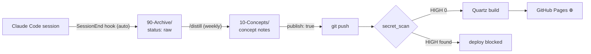

<div align="center">

# █ LLM WIKI

**From sessions to knowledge — a personal LLM wiki distilled from Claude Code work logs**

[](https://joon56.github.io/my-llm-wiki/)
[](https://github.com/joon56/my-llm-wiki/actions/workflows/deploy.yml)
[](https://quartz.jzhao.xyz)
[](https://obsidian.md)
[](#-tests)

Written in [Obsidian](https://obsidian.md) · built with [Quartz 4](https://quartz.jzhao.xyz) · published on GitHub Pages.
Claude Code sessions are archived automatically; a `/distill` routine promotes only the reusable lessons into concept notes.

**[→ Visit the wiki](https://joon56.github.io/my-llm-wiki/)** · KR/EN toggle · Light = brutalist / Dark = neon

**English** | [한국어](README.ko.md)

</div>

---

## 📐 Pipeline



Three layers: **raw archive** (auto-collected, never published) → **concept notes** (human-distilled) → **MOC** (topic maps). The wiki is the conclusions extracted from the logs, not the logs themselves.

## 🗂 Structure

```
LLM_WIKI/                        ← git root (monorepo)
├── vault/                       ← Obsidian vault. All content
│   ├── 00-Inbox/                # unprocessed memos, emptied weekly
│   ├── 10-Concepts/             # ★ the actual wiki. one concept = one note
│   ├── 20-Techniques/           # reusable recipes/patterns
│   ├── 30-Tools/                # per-tool notes (Claude Code, vLLM, ...)
│   ├── 40-Projects/             # active project notes
│   ├── 50-MOC/                  # topic maps (site home entry point)
│   ├── 90-Archive/claude-sessions/  # session logs. local-only, read-only, never published
│   ├── 99-Meta/                 # how-to guides for this wiki
│   ├── en/                      # English translations (KR/EN toggle pairs)
│   ├── _templates/              # Templater templates
│   └── CLAUDE.md                # vault rulebook (read this first)
├── site/                        ← Quartz 4. Builds vault/ as its content source
├── scripts/                     ← Python tools (stdlib only)
│   ├── cc2obsidian.py           # JSONL → md converter
│   ├── archive_session.py       # SessionEnd hook entry point
│   ├── secret_scan.py           # secret scanner (doubles as CI gate)
│   └── tests/                   # 11 unit tests
├── _dropbox/                    ← drop claude.ai exports here (gitignored) → /ingest
├── .claude/commands/distill.md  # weekly distill routine command
├── .claude/commands/ingest.md   # claude.ai export converter routine
├── .github/workflows/deploy.yml # scan → build → Pages deploy
└── docs/superpowers/            # design spec & implementation plan
```

## ⚡ Setup

### 1️⃣ Obsidian

1. Open Obsidian → **Open folder as vault** → select `vault/`
2. Settings → Core plugins: enable **Backlinks**, **Graph view**, **Templates**
3. Settings → Community plugins → turn off Restricted mode → install & enable exactly these three:

   | Plugin | Role |
   |---|---|
   | **Dataview** | property-driven auto lists (distill queue, etc.) |
   | **Templater** | template insertion on note creation |
   | **Omnisearch** | full-text search (scales to hundreds of archives) |

4. Settings → Templates (or Templater) → set template folder to `_templates`
5. Settings → Files & Links → set "New link format" to **shortest path**, enable "Use [[Wikilinks]]"
6. When `vault/.obsidian/` is created, workspace files (`workspace*.json`, `cache`) are already gitignored — commit only the config files

> Why only three plugins: LLM-related plugins are deliberately excluded. Running Claude Code inside the vault is the more powerful substitute.

### 2️⃣ Node (site build)

```bash
cd site
npm install
npx quartz build -d ../vault -o public           # static site → site/public
npx quartz build -d ../vault -o public --serve   # local preview: http://localhost:8080
```

`site/package.json` engines: `node >= 22`, `npm >= 10.9.2`

> ⚠️ **Quartz is vendored from the upstream `v4` branch, pinned via `git clone --branch v4` (version 4.5.2).** Upstream's default branch has moved on to v5, so any reinstall/upgrade must specify the branch: `git clone --branch v4 https://github.com/jackyzha0/quartz.git`. A plain clone fetches v5, which is incompatible with this repo's customizations (brutalist/neon theme, self-hosted fonts, language toggle).

### 3️⃣ Python (tools)

Standard library only, zero external dependencies. On Windows, prefer the `py` launcher over `python` (the scripts force UTF-8 stdio, so either works).

```bash
cd scripts
py -m unittest      # 11 tests
```

## 🔁 Daily workflow

> **Write a note → `publish: true` → push → auto-deploy.** That's the whole loop.

- **Publishing is controlled solely by the `publish: true` property** — unpublished by default (Quartz `ExplicitPublish` filter)
- `vault/90-Archive/` is double-blocked by `ignorePatterns` + `.gitignore` — it never publishes even with `publish: true`, and never reaches git
- New notes follow the `_templates/` format (YAML: `title`, `tags`, `status`, `created`). Links are `[[wikilinks]]` only — no markdown links. Full rules: `vault/CLAUDE.md`

### 🤖 Automatic session archiving

A global `SessionEnd` hook runs `scripts/archive_session.py` whenever a Claude Code session ends, saving it to `vault/90-Archive/claude-sessions/` with `status: raw`. The hook is best-effort — failures never block session exit and are only logged to `_hook-errors.log`.

<details>
<summary><b>Bulk-import past sessions (manual)</b></summary>

```bash
py scripts/cc2obsidian.py --out vault/90-Archive/claude-sessions --min-prompts 3 --index
```

`--min-prompts` filters out low-signal sessions; `--index` also generates an MOC index note. Full options: `py scripts/cc2obsidian.py --help`

</details>

### 📥 /ingest — claude.ai conversations

Claude **desktop app / claude.ai** conversations have no local logs, so they come in via the official data export: claude.ai → Settings → Privacy → **Export data** → drop the emailed zip (or `conversations.json`) into `_dropbox/` → run `/ingest`. Conversations are converted into `vault/90-Archive/claudeai/` (`status: raw`, deduplicated by UUID across repeated exports), then successfully processed files are removed from `_dropbox/`. See `_dropbox/README.md`.

### ⚗️ /distill — weekly distillation

`.claude/commands/distill.md` — reads recent `status: raw` session notes and classifies/promotes reusable lessons.

| Step | Action | Safeguard |
|---|---|---|
| 1 | present a lessons-found/none classification table | no files created at this stage |
| 2 | no lessons → `status: triaged` | — |
| 3 | lessons → propose 3 title candidates each | **the user confirms titles** |
| 4 | create confirmed notes in `10-Concepts/` | starts as `publish: false` |
| 5 | source note → `status: distilled` + backlink | — |
| 6 | on publish approval, **create the English version too** | linked via KR/EN toggle |

Never more than 5 concept notes per run.

## 🔒 Secret scan

```bash
py scripts/secret_scan.py vault
```

| Level | Patterns | Handling |
|---|---|---|
| **HIGH** | `sk-ant-…`, `AKIA…`, GitHub tokens, PEM private keys | exit 1 — **blocks deploy in CI** |
| MEDIUM | `Bearer …`, `api_key = "..."` style generics | warning only (exit 0) |

CI (`.github/workflows/deploy.yml`) runs the scan before every build. If HIGH fires: don't edit files blindly — **rotate the key first**, then remove it from the note.

## 🌐 Translation rules (KR/EN)

Published notes with an English counterpart are linked through the **KR/EN toggle** at the top of every page.

- **Paths**: English notes mirror the Korean folder structure under `vault/en/` (e.g. `vault/50-MOC/LLM MOC.md` ↔ `vault/en/50-MOC/LLM MOC (EN).md`). **Never reuse the exact Korean filename** — Quartz's `shortest` link resolution collides on the slug's last segment and breaks wikilinks
- **Frontmatter**: paired notes declare `lang: ko|en` + `translation: <relative slug>` (e.g. `en/50-MOC/LLM-MOC-(EN)`). When unsure, verify against actual output paths in `site/public` after a build
- Notes without a `translation` property simply render no toggle — unpaired notes are fine as-is
- **Only published notes need translations**: `publish: true` notes are the target. When publishing a new note, add its English version under the same rules

## 🧪 Tests

```bash
cd scripts && py -m unittest
```

## 🛠 Troubleshooting

| Symptom | Cause / fix |
|---|---|
| Dataview tables missing on the site | **Expected.** Dataview is Obsidian-only — view rendered results in Obsidian |
| Many cc2obsidian parse errors | The JSONL transcript format is **unofficial** and may change between versions. Check with `--debug`; if failures are widespread, fall back to `/export` |
| Note titles are UUIDs | Session had no summary. Expected — humans re-title during `/distill` |
| Notes too long | Re-convert with `cc2obsidian.py --max-chars 15000` |
| 90-Archive content visible on the site | Should never happen. Check `"90-Archive"` is in `ignorePatterns` in `site/quartz.config.ts`, then verify with `grep -ril "90-Archive" site/public/` |
| secret_scan misses a key | It's a heuristic covering known formats only — not a guarantee. Eyeball before committing |
| Broken Korean text on Windows | Scripts force UTF-8 stdio. If still broken, check the terminal codepage (`chcp 65001`) |

---

<div align="center">

**Minjoon Yoo** · [GitHub](https://github.com/joon56) · [yoominjoon.com](https://yoominjoon.com) · [webdamo56@gmail.com](mailto:webdamo56@gmail.com)

</div>
